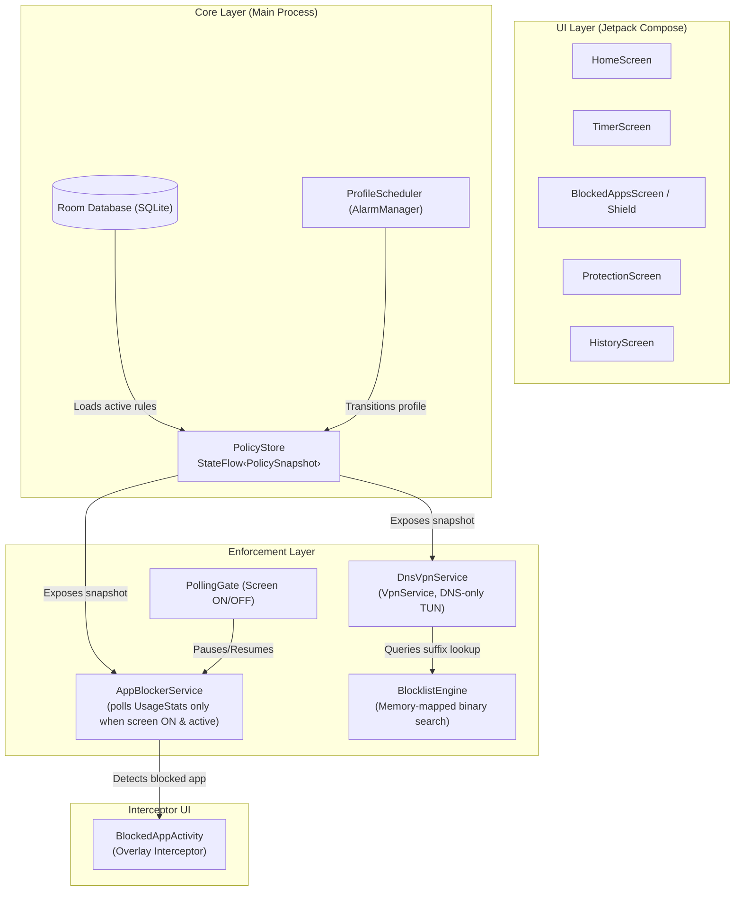

# FocusForge Architecture

## 1. System Philosophy & Rules
Core rule: **NOTHING RUNS UNLESS SOMETHING NEEDS IT RIGHT NOW.**
Always-on components are tiny and strictly event-driven. Heavy processes (e.g. AI/TTS/ASR) live in separate isolated processes loaded on demand and unloaded when idle.

### Layers:
1. **UI (Compose)**: Onboarding, companion, dashboards, planner. Runs only when visible in foreground.
2. **CORE (Main Process)**: Room DB, `PolicyStore` (`StateFlow<PolicySnapshot>`), Scheduler (`AlarmManager`-driven profile & block transitions), rule-based intent router, FSRS, WorkManager jobs. Remains ~0% CPU at idle.
3. **ENFORCEMENT (Main Process for now)**: Foreground-app watcher (`AppBlockerService`), DNS-only VPN (`DnsVpnService`), block interceptor screen (`BlockedAppActivity`). Reads **ONLY** `PolicySnapshot`, never talks to Room directly.
4. **AI PROCESS (`:ai`, isolated & killable)**: Speech recognition, VAD, TTS, LLM providers. Loads on demand, unloads after ~60s idle. Never runs during DEEP blocks unless explicitly requested.
5. **BACKGROUND JOBS (WorkManager)**: Runs strictly while device is charging and idle (audio pre-rendering, local backups).

### Invariants & Safety Guarantees:
- **Never lock user out**: Phone, SMS, Dialer, System Settings, Emergency Bypass (60s hold-to-unlock) are hard-exempt and never blocked.
- **Fail OPEN**: If enforcement or VPN fails, all normal networking and app launching continue working unimpeded. A persistent "Protection is off" alert appears with a 1-tap restart.
- **Local-first & Private**: 100% on-device. No analytics, no telemetry, no tracking. DNS queries are evaluated against memory-mapped local binary files; queried domains and voice transcripts never leave the device.
- **Rule Changes**: Strengthening rules is instant. Weakening rules will be governed by a tamper delay (Phase 5).

---

## 2. Component Diagram

