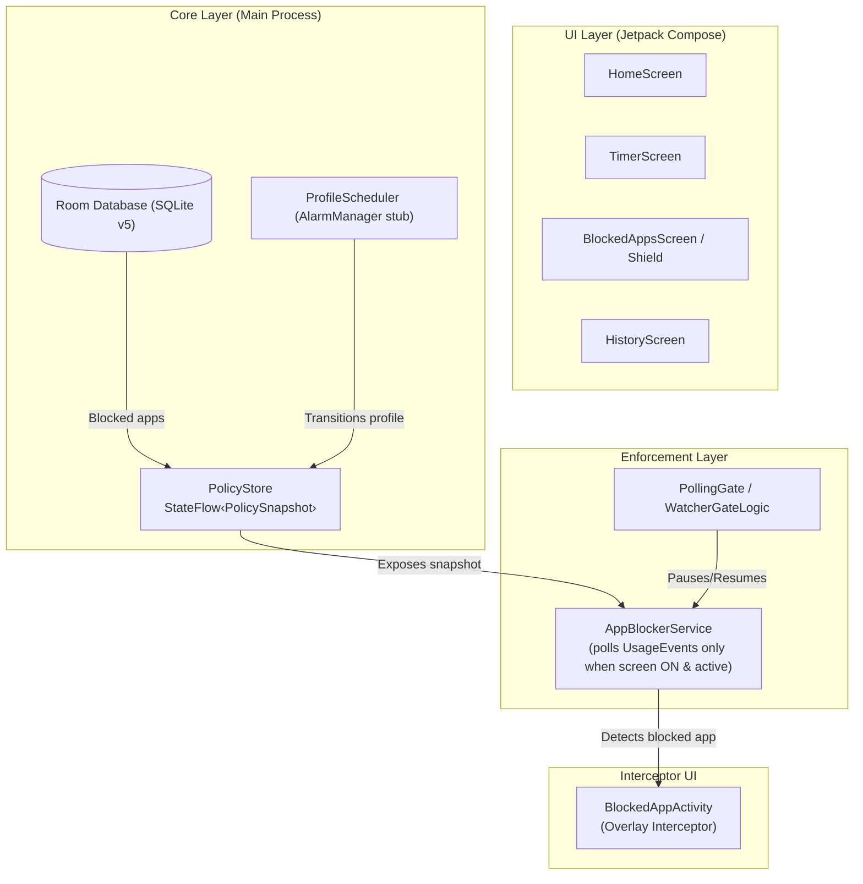

# FocusForge Architecture

## 1. System Philosophy & Rules
Core rule: **NOTHING RUNS UNLESS SOMETHING NEEDS IT RIGHT NOW.**
Always-on components are tiny and strictly event-driven. Heavy processes (e.g. AI/TTS/ASR) live in separate isolated processes loaded on demand and unloaded when idle.

### Layers:
1. **UI (Compose)**: Onboarding, companion, dashboards, planner. Runs only when visible in foreground.
2. **CORE (Main Process)**: Room DB, `PolicyStore` (`StateFlow<PolicySnapshot>`), `ProfileScheduler` (`AlarmManager` stub in Phase 3; scheduled blocks in Phase 4). Remains ~0% CPU at idle.
3. **ENFORCEMENT**: Foreground-app watcher (`AppBlockerService` gated by `PollingGate` / `WatcherGateLogic`), DNS-only VPN (`DnsVpnService`, R3), block interceptor screen (`BlockedAppActivity`). Reads **ONLY** `PolicySnapshot`, never touches Room directly.
4. **AI PROCESS (`:ai`, isolated & killable)**: Speech recognition, VAD, TTS, LLM providers (future phases).
5. **BACKGROUND JOBS (WorkManager)**: Runs strictly while device is charging and idle.

### Invariants & Safety Guarantees:
- **Never lock user out**: Phone, SMS, Dialer, System Settings, Emergency Bypass (60s hold-to-unlock) are hard-exempt and never blocked.
- **Fail OPEN**: If enforcement or VPN fails, all normal networking and app launching continue working unimpeded. A persistent notification offers a 1-tap restart.
- **Local-first & Private**: 100% on-device. No analytics, no telemetry, no tracking. No queried domain is ever written to disk or logs; only aggregate counters.
- **Rule Changes**: Strengthening rules is instant. Weakening rules will be governed by a tamper delay (`RuleChangeGate`, Phase 5).

---

## 2. Profile-to-Category Table

| Profile | App Blocking | `ADULT_CORE` | `ADULT_EXTENDED` | `DISTRACTION` | `DOH_ENDPOINTS` |
|---|---|---|---|---|---|
| `OFF` | Inactive | User pref (default ON) | User pref (default OFF) | Inactive | User pref (default ON) |
| `RELAXED` | Active (if non-empty) | User pref (default ON) | User pref (default OFF) | Inactive | User pref (default ON) |
| `STRICT` | Active (if non-empty) | User pref (default ON) | User pref (default OFF) | User pref (default OFF) | User pref (default ON) |

- **Baseline (`ADULT_CORE` + `DOH_ENDPOINTS`)**: High-confidence adult filter + DoH bypass prevention sit underneath as quiet infrastructure.
- **`ADULT_EXTENDED`**: Aggressive adult list, OFF by default, opt-in with warning.
- **`DISTRACTION`**: Never a domain-wide default; applies only under `STRICT` (and future Phase 4 scheduled/trigger profiles).

---

## 3. Component Diagram

