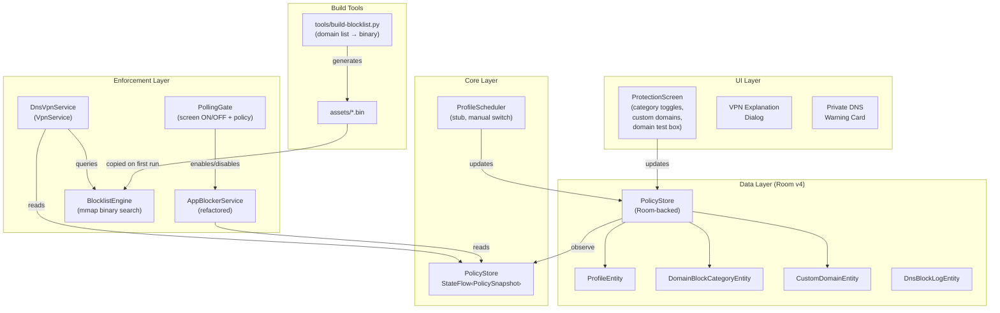

# FocusForge — Phase 3 Proposal: DNS-Only VPN and Site Blocking

## Phase 2 Confirmation Checklist

Before implementing Phase 3, the following Phase 2 items need to be confirmed as working correctly on the device.

| Item | Status | Notes |
|------|--------|-------|
| App blocking intercepts blocked apps within ~1s | Needs test | Confirm on Vivo I2223 after latest push |
| Exempt apps (Phone, SMS, Dialer, Settings) pass through | Needs test | Also verify Vivo's default dialer/SMS packages |
| Emergency bypass hold-to-confirm activates 60s window | Needs test | Check BlockedAppActivity overlay appears correctly |
| Bypass logs recorded in Room `emergency_bypass_logs` table | Needs test | Verify via Shield > Bypass History tab |
| Blocked app attempts logged with 3s dedup | Needs test | Verify via Shield > Attempts tab |
| Screen time wall-clock dedup working accurately | Needs test | Compare with Digital Wellbeing totals |
| Boot persistence restarts blocker via `BootCompletedReceiver` | Needs test | Reboot device with blocker enabled |
| Battery drain over 30min with blocker ON vs OFF | Needs measure | Baseline measurement before Phase 3 adds VPN |
| `exportSchema = false` in AppDatabase | Confirmed | Master prompt says `exportSchema = true` — needs decision |
| Polling runs even when screen is OFF | Confirmed | Phase 2 polls unconditionally; Phase 3 adds the screen-on/off gate |

> [!IMPORTANT]
> **Action required**: Run the app on your Vivo device and confirm each row above. The battery baseline (blocker ON vs OFF for 30 min) is critical — Phase 3 adds the VPN layer and we need a before/after comparison.

---

## Overview

Phase 3 introduces DNS-based content and distraction site blocking through a local-only VPN that intercepts DNS queries and blocks domains matching adult, distraction, and DNS-over-HTTPS bypass categories. It also establishes the **PolicyStore** architecture that unifies app blocking (Phase 2) and domain blocking under a single profile system (OFF / RELAXED / STRICT).

### Goals
- Block adult, distraction, and DoH-bypass domains at the DNS level using a local VpnService
- Introduce `PolicyStore` with `StateFlow<PolicySnapshot>` as the single source of truth for all blocking rules
- Refactor the Phase 2 `AppBlockerService` polling to gate on screen ON/OFF state
- Provide compact, memory-mapped binary blocklists built from open-source domain lists
- Create a Protection settings screen with category toggles, custom allow/block domains, and a domain test box

### Non-Goals
- No HTTPS traffic inspection (we only intercept DNS)
- No blocking of DoH to hard-coded IP addresses (documented limitation)
- No tamper delay (Phase 5)
- No alarm-driven profile scheduling (Phase 4 — only a manual profile switch for testing)
- No separate `:enforcer` process (stays in main process unless profiling shows need)

---

## Architecture



---

## Sub-steps

### 3a. PolicyStore and Polling Gate

**Goal**: Create a Room-backed `PolicyStore` exposing `StateFlow<PolicySnapshot>` as the single source of truth for all blocking rules. Refactor the Phase 2 watcher to only poll when the screen is ON and a blocking profile is active.

**PolicySnapshot data class**:
```kotlin
data class PolicySnapshot(
    val activeProfile: BlockingProfile,       // OFF, RELAXED, STRICT
    val blockedAppPackages: Set<String>,       // from Phase 2 blocked_apps table
    val enabledDomainCategories: Set<DomainCategory>, // ADULT, DISTRACTION, DOH_ENDPOINTS
    val customBlockedDomains: Set<String>,
    val customAllowedDomains: Set<String>
)

enum class BlockingProfile { OFF, RELAXED, STRICT }
enum class DomainCategory { ADULT, DISTRACTION, DOH_ENDPOINTS }
```

**Profile defaults table**:

| Profile | App Blocking | ADULT domains | DISTRACTION domains | DOH_ENDPOINTS |
|---------|-------------|---------------|---------------------|---------------|
| OFF | Disabled | Blocked | Not blocked | Blocked |
| RELAXED | Enabled | Blocked | Blocked | Blocked |
| STRICT | Enabled | Blocked | Blocked | Blocked |

> [!NOTE]
> ADULT and DOH_ENDPOINTS are always blocked regardless of profile. DISTRACTION domains are only blocked under RELAXED and STRICT. App blocking only engages under RELAXED and STRICT.

**Polling gate refactor**: Register `ACTION_SCREEN_ON` / `ACTION_SCREEN_OFF` broadcast receivers dynamically in `AppBlockerService`. When screen is OFF, stop the polling loop. When screen turns ON and a blocking profile is active with a non-empty blocked set, restart polling.

**How to test on phone**:
1. Switch profile to STRICT in settings — verify AppBlockerService starts polling
2. Turn screen off — verify polling stops (check logcat for "polling paused")
3. Turn screen on — verify polling resumes
4. Switch profile to OFF — verify AppBlockerService stops and notification disappears
5. Switch back to STRICT — verify service restarts

---

### 3b. Compact Blocklist Engine

**Goal**: Build a Gradle/Python tool that converts open-source domain blocklists into compact binary files. Implement a suffix-aware lookup engine using memory-mapped binary search.

**Binary format**: Sorted array of 64-bit SipHash values of normalized domains (lowercase, no trailing dot, no `www.` prefix). One `.bin` file per category.

**Suffix-aware matching**: To check if `a.b.example.com` is blocked:
1. Check `a.b.example.com` → not in list
2. Check `b.example.com` → not in list
3. Check `example.com` → found, **blocked**

The key point: `notexample.com` does NOT match `example.com` because we match complete labels, not substrings.

**Domain normalization rules**:
- Lowercase
- Strip trailing dot
- Strip leading `www.`
- Punycode-encode IDN domains
- Reject IPs and malformed entries

**Upstream source lists (GPLv3-compatible)**:

| Category | Source | License | Approx. domains |
|----------|--------|---------|-----------------|
| ADULT | [StevenBlack/hosts](https://github.com/StevenBlack/hosts) (porn extension) | MIT | ~30k |
| ADULT | [oisd.nl nsfw](https://oisd.nl/) | MIT-like, free use | ~100k |
| DISTRACTION | [StevenBlack/hosts](https://github.com/StevenBlack/hosts) (social, gambling) | MIT | ~5k |
| DOH_ENDPOINTS | [curl/curl wiki DoH list](https://github.com/curl/curl/wiki/DNS-over-HTTPS) + manual curation | Public domain / manual | ~200 |

> [!WARNING]
> License verification is required before including each list. I will verify the exact license terms and record them in `/docs/THIRD_PARTY.md` and `/docs/SOURCES.md` during implementation.

**Custom lists precedence**: Allow > Block > Category blocklist. A domain in the allowlist always passes, even if it matches a category.

**How to test on phone**:
1. Build the app — blocklist `.bin` files should appear in `assets/`
2. First app launch copies them to `filesDir` — verify file sizes in logcat
3. Unit tests: exact match, subdomain match, `notexample.com` no-match, allowlist override, punycode, empty input

---

### 3c. DNS-Only VPN Service

**Goal**: Implement a `VpnService` that routes ONLY DNS traffic through a local tunnel, parses DNS queries, consults the blocklist engine, and returns NXDOMAIN for blocked domains or forwards to upstream for allowed ones.

**VPN tunnel configuration**:
```kotlin
builder.addAddress("10.0.0.2", 32)                   // IPv4 tunnel address
builder.addAddress("fd00::2", 128)                     // IPv6 tunnel address
builder.addDnsServer("10.0.0.1")                       // Virtual DNS IPv4
builder.addDnsServer("fd00::1")                        // Virtual DNS IPv6
builder.addRoute("10.0.0.1", 32)                       // Route ONLY the DNS address
builder.addRoute("fd00::1", 128)                       // Route ONLY the DNS address
builder.addDisallowedApplication("com.focusforge.app") // Own-app bypass
builder.setBlocking(true)
builder.setMtu(1500)
```

> [!IMPORTANT]
> By routing only the virtual DNS addresses (`10.0.0.1/32` and `fd00::1/128`), all non-DNS traffic bypasses the VPN entirely. This means zero performance impact on browsing, downloads, and streaming. The VPN only intercepts DNS resolution requests.

**DNS packet handling**:
1. Read packet from tunnel file descriptor
2. Parse DNS query (handle UDP; TCP fallback if truncated response)
3. Extract queried domain name (handle compressed names, EDNS)
4. Consult `PolicySnapshot.enabledDomainCategories` → `BlocklistEngine.isBlocked(domain)`
5. If blocked: build NXDOMAIN response (or `0.0.0.0` / `::` per setting) and write back
6. If allowed: forward query to upstream resolver via a `protect()`ed UDP socket, read response, write back

**Upstream resolver**: Default to the system DNS. Configurable in settings (e.g., `1.1.1.1`, `8.8.8.8`). Socket is `protect()`ed so it bypasses the VPN tunnel.

**Concurrency**: Single reader thread on the TUN fd, bounded thread pool (4 threads) for forwarding. No unbounded buffers. Sockets closed with 5s timeout.

**Foreground service type**: On API 34+ (Android 14), `VpnService` does not need an explicit `foregroundServiceType` — Android implicitly treats VPN services as foreground. The VPN permission dialog is the system's own. We start the foreground notification with our own channel.

**Lifecycle**:
- Start when at least one DNS category is enabled in `PolicySnapshot`
- Stop when all DNS categories are disabled
- Handle `onRevoke()`: stop, show "Protection OFF" notification with one-tap restart
- Handle network change (`CONNECTIVITY_ACTION`): re-resolve upstream DNS
- Handle airplane mode: gracefully stop forwarding, resume when connectivity returns
- Boot: restart via `BootCompletedReceiver` if protection was enabled (uses existing SharedPreferences flag)

**How to test on phone**:
1. Enable ADULT category — VPN permission dialog appears with explanation
2. Open Chrome, navigate to a known adult domain — should get "site can't be reached" (NXDOMAIN)
3. Try the same in Firefox (normal and private) — same result
4. Navigate to a non-blocked domain — should load normally
5. Check VPN notification: "Protection on — X domains blocked today"
6. Disable all categories — VPN disconnects, notification disappears

---

### 3d. DoH Bypass Handling and Own-App Bypass

**Goal**: Block known DNS-over-HTTPS endpoints so browsers fall back to system DNS (which our VPN intercepts). Exclude FocusForge from the VPN so future features (YouTube player, model downloads) work.

**DOH_ENDPOINTS**: Resolve known DoH hostnames (e.g., `dns.google`, `cloudflare-dns.com`, `dns.quad9.net`, `doh.opendns.com`, `mozilla.cloudflare-dns.com`) to NXDOMAIN. This forces browsers like Chrome and Firefox to fall back to standard DNS resolution, which our VPN intercepts.

**Documented limitation**: If a browser or app connects to a DoH server by IP address (e.g., `https://8.8.8.8/dns-query`), our DNS-only VPN cannot intercept it. This is stated clearly in-app and in the README.

**Private DNS detection**: Check `Settings.Global.getString(contentResolver, "private_dns_mode")`. If set to `hostname` (strict mode), show a warning card in the Protection screen explaining that Private DNS bypasses our filter, with a button to open `Settings.ACTION_WIRELESS_SETTINGS`.

**Own-app bypass**: `builder.addDisallowedApplication("com.focusforge.app")` — with a code comment explaining this is needed for the Phase 10 YouTube player, future model downloads, and sync.

**How to test on phone**:
1. With protection ON, open Chrome settings and check if "Use secure DNS" falls back (Chrome respects system DNS when DoH endpoints are unreachable)
2. Test Firefox: about:config > `network.trr.mode` — should fall back to standard DNS
3. Enable Private DNS in system settings — verify warning card appears in Protection screen
4. Verify FocusForge itself can still reach the internet (for future features)

---

### 3e. Integration, Measurement, and Docs

**Goal**: Unify app blocking and DNS blocking under one profile switch. Add VPN permission to the onboarding flow. Measure battery and memory impact.

**Integration**: When the user switches profile (e.g., OFF → STRICT):
- `PolicyStore` updates the `PolicySnapshot`
- `AppBlockerService` reads the new snapshot and starts/stops accordingly
- `DnsVpnService` reads the new snapshot and starts/stops accordingly
- Both services react to the same `StateFlow<PolicySnapshot>`

**Onboarding update**: Add VPN permission step to `PermissionsScreen`:
- Shows before the system VPN dialog
- Plain-language explanation: "FocusForge uses a local VPN to filter DNS requests on your device. No traffic leaves your phone through us — it only blocks harmful domains locally."
- Each permission is skippable

**Battery/memory measurement plan**:
1. **Baseline** (Phase 2 only, no VPN): `adb shell dumpsys batterystats` over 30 min of normal use
2. **With VPN**: Same measurement with DNS blocking enabled
3. **Target**: <2% additional battery drain, <10MB PSS increase for the VPN thread pool
4. **Report**: Include in `/docs/STATUS.md` with actual measured numbers

**How to test on phone**:
1. Full flow: Enable protection from OFF → verify VPN starts + app blocker starts
2. Disable protection → verify both stop
3. Reboot with protection ON → verify both restart
4. Airplane mode toggle → VPN recovers gracefully
5. Revoke VPN from system settings → "Protection OFF" notification appears
6. Battery test: 30 min ON vs OFF comparison

---

## Room Schema Changes (v3 → v4)

### New Tables

#### `profiles`
| Column | Type | Notes |
|--------|------|-------|
| `id` | `String` | PK — `"default"` for now, extensible for multiple profiles |
| `activeProfile` | `String` | `"OFF"`, `"RELAXED"`, or `"STRICT"` |
| `updatedAt` | `Long` | Epoch millis |

#### `domain_block_categories`
| Column | Type | Notes |
|--------|------|-------|
| `category` | `String` | PK — `"ADULT"`, `"DISTRACTION"`, `"DOH_ENDPOINTS"` |
| `isEnabled` | `Integer` | 1 = enabled, 0 = disabled |
| `profileId` | `String` | FK → profiles.id |

#### `custom_domains`
| Column | Type | Notes |
|--------|------|-------|
| `id` | `Long` | Auto-generated PK |
| `domain` | `String` | Normalized domain |
| `listType` | `String` | `"ALLOW"` or `"BLOCK"` |
| `addedAt` | `Long` | Epoch millis |

#### `dns_block_log`
| Column | Type | Notes |
|--------|------|-------|
| `id` | `Long` | Auto-generated PK |
| `domain` | `String` | Queried domain (we store only the domain, never full URLs or query paths) |
| `category` | `String` | Which category matched |
| `timestamp` | `Long` | Epoch millis |
| `wasBlocked` | `Integer` | 1 = blocked, 0 = allowed (for the counter) |

> [!CAUTION]
> **Privacy**: The `dns_block_log` table stores only domain names and aggregate counters. No full URLs, no query parameters, no user content. The master prompt says "only aggregate counters" — we may want to store only daily category counts instead of per-query logs. See **Open Question 2** below.

### Migration SQL (MIGRATION_3_4)

```kotlin
val MIGRATION_3_4 = object : Migration(3, 4) {
    override fun migrate(db: SupportSQLiteDatabase) {
        // profiles table
        db.execSQL("""
            CREATE TABLE IF NOT EXISTS `profiles` (
                `id` TEXT NOT NULL PRIMARY KEY,
                `activeProfile` TEXT NOT NULL DEFAULT 'OFF',
                `updatedAt` INTEGER NOT NULL DEFAULT 0
            )
        """)
        db.execSQL("""
            INSERT OR IGNORE INTO `profiles` (`id`, `activeProfile`, `updatedAt`)
            VALUES ('default', 'OFF', ${System.currentTimeMillis()})
        """)

        // domain_block_categories table
        db.execSQL("""
            CREATE TABLE IF NOT EXISTS `domain_block_categories` (
                `category` TEXT NOT NULL PRIMARY KEY,
                `isEnabled` INTEGER NOT NULL DEFAULT 1,
                `profileId` TEXT NOT NULL DEFAULT 'default'
            )
        """)
        // Insert defaults: ADULT and DOH always on, DISTRACTION off by default
        db.execSQL("INSERT OR IGNORE INTO `domain_block_categories` VALUES ('ADULT', 1, 'default')")
        db.execSQL("INSERT OR IGNORE INTO `domain_block_categories` VALUES ('DOH_ENDPOINTS', 1, 'default')")
        db.execSQL("INSERT OR IGNORE INTO `domain_block_categories` VALUES ('DISTRACTION', 0, 'default')")

        // custom_domains table
        db.execSQL("""
            CREATE TABLE IF NOT EXISTS `custom_domains` (
                `id` INTEGER PRIMARY KEY AUTOINCREMENT NOT NULL,
                `domain` TEXT NOT NULL,
                `listType` TEXT NOT NULL,
                `addedAt` INTEGER NOT NULL
            )
        """)

        // dns_block_log table
        db.execSQL("""
            CREATE TABLE IF NOT EXISTS `dns_block_log` (
                `id` INTEGER PRIMARY KEY AUTOINCREMENT NOT NULL,
                `domain` TEXT NOT NULL,
                `category` TEXT NOT NULL,
                `timestamp` INTEGER NOT NULL,
                `wasBlocked` INTEGER NOT NULL DEFAULT 1
            )
        """)
    }
}
```

> [!IMPORTANT]
> As always, explicit migration only — no `fallbackToDestructiveMigration()`. All Phase 1 sessions and Phase 2 blocked apps are preserved.

---

## New Files

### Data Layer

| File | Purpose |
|------|---------|
| `data/local/entity/ProfileEntity.kt` | Room entity for `profiles` table |
| `data/local/entity/DomainBlockCategoryEntity.kt` | Room entity for `domain_block_categories` table |
| `data/local/entity/CustomDomainEntity.kt` | Room entity for `custom_domains` table |
| `data/local/entity/DnsBlockLogEntity.kt` | Room entity for `dns_block_log` table |
| `data/local/dao/ProfileDao.kt` | CRUD for profiles |
| `data/local/dao/DomainBlockCategoryDao.kt` | Toggle categories, get enabled set |
| `data/local/dao/CustomDomainDao.kt` | Add/remove custom allow/block domains |
| `data/local/dao/DnsBlockLogDao.kt` | Insert logs, get today's count, get recent entries |
| `data/model/PolicyModels.kt` | `PolicySnapshot`, `BlockingProfile`, `DomainCategory` data classes/enums |
| `data/repository/PolicyRepository.kt` | Interface + impl: combines profile + categories + blocked apps + custom domains into `StateFlow<PolicySnapshot>` |

### Enforcement Layer

| File | Purpose |
|------|---------|
| `enforcement/BlocklistEngine.kt` | Memory-mapped binary search over `.bin` files. Suffix-aware domain lookup. |
| `enforcement/DnsPacketParser.kt` | Parse and build DNS UDP packets (query extraction, NXDOMAIN/response construction) |
| `enforcement/DnsVpnService.kt` | `VpnService` subclass: TUN fd reader, DNS interception, forwarding, NXDOMAIN for blocked domains |
| `enforcement/PollingGate.kt` | Screen ON/OFF broadcast receiver that controls `AppBlockerService` polling lifecycle |

### UI Layer

| File | Purpose |
|------|---------|
| `ui/protection/ProtectionScreen.kt` | Category toggles, custom domain input (validated), "test a domain" box, today's blocked count |
| `ui/protection/ProtectionViewModel.kt` | Manages `PolicySnapshot` observation, category toggle, custom domain CRUD, domain test |
| `ui/protection/VpnExplanationDialog.kt` | Plain-language VPN explanation shown before the system VPN permission dialog |
| `ui/protection/PrivateDnsWarningCard.kt` | Warning shown when Private DNS strict mode is detected |

### Build Tools

| File | Purpose |
|------|---------|
| `tools/build-blocklist.py` | Python script: downloads upstream domain lists, normalizes, hashes, sorts, writes `.bin` |
| `tools/README.md` | How to run the script, expected output, how to add new lists |

### Documentation

| File | Purpose |
|------|---------|
| `docs/SOURCES.md` | Every upstream blocklist: name, URL, license, date fetched, domain count |
| `docs/THIRD_PARTY.md` | All third-party dependencies with license info |
| `docs/ARCHITECTURE.md` | Updated architecture diagram reflecting PolicyStore and enforcement layers |
| `docs/STATUS.md` | Phase progress table with dates and measured numbers |

---

## Modified Files

| File | Change |
|------|--------|
| `AndroidManifest.xml` | Add `<service android:name=".enforcement.DnsVpnService">` with VPN intent-filter, add `BIND_VPN_SERVICE` permission |
| `data/local/AppDatabase.kt` | Add 4 new entities + DAOs, bump to v4, add `MIGRATION_3_4` |
| `di/AppModule.kt` | Provide new DAOs: `ProfileDao`, `DomainBlockCategoryDao`, `CustomDomainDao`, `DnsBlockLogDao` |
| `di/RepositoryModule.kt` | Bind `PolicyRepository` |
| `service/AppBlockerService.kt` | Refactor to read from `PolicySnapshot` instead of direct Room queries; add screen ON/OFF gating via `PollingGate`; update notification to include DNS blocked count |
| `receiver/BootCompletedReceiver.kt` | Also restart `DnsVpnService` if DNS categories were enabled |
| `FocusForgeApp.kt` | Add `VPN_CHANNEL_ID` notification channel |
| `ui/navigation/Screen.kt` | Add `Protection` screen route |
| `ui/navigation/NavGraph.kt` | Add `Protection` composable route (accessible from Shield tab or Settings) |
| `ui/blocker/BlockedAppsScreen.kt` | Add "Domain Protection" section/button linking to `ProtectionScreen` |
| `ui/permissions/PermissionsScreen.kt` | Add VPN permission step with `VpnExplanationDialog` |
| `ui/home/HomeScreen.kt` | Show DNS protection status alongside app blocker status |
| `ui/home/HomeViewModel.kt` | Observe `PolicySnapshot` for DNS protection state |

---

## Permissions

| Permission | Why | How Granted |
|------------|-----|-------------|
| `BIND_VPN_SERVICE` | Required for VpnService to create a TUN interface | System VPN permission dialog (user consent) |
| `FOREGROUND_SERVICE` | Already declared (Phase 1) | Declared in manifest |
| `FOREGROUND_SERVICE_SPECIAL_USE` | Already declared (Phase 1) | Declared in manifest |

> [!NOTE]
> `VpnService` on Android does not require a separate `foregroundServiceType`. The system VPN permission dialog is the trust gate. The VPN service uses its own notification channel but does not need `FOREGROUND_SERVICE_SPECIAL_USE` — only the app blocker and timer services use that type.

---

## Battery and Memory Budget

| Metric | Target | How Measured |
|--------|--------|--------------|
| Idle CPU (screen off, VPN on, no DNS queries) | <0.5% | `adb shell dumpsys batterystats` |
| Active CPU (normal browsing, VPN intercepting DNS) | <2% above baseline | `adb shell dumpsys batterystats` over 30 min |
| PSS (DnsVpnService thread pool) | <10 MB | `adb shell dumpsys meminfo com.focusforge.app` |
| Blocklist memory (mmap, not heap) | ~2 MB per category file (not counted in PSS) | `ls -la` on `filesDir/*.bin` |
| DNS query latency (allowed domains) | <10ms added over direct resolution | Manual timing in logcat |
| Battery drain (30 min screen-on use) | <2% more than without VPN | Before/after batterystats comparison |

---

## Risks and Android Quirks

| Risk | Mitigation |
|------|------------|
| **Only one VPN can be active at a time** on Android. If the user has another VPN (NordVPN, work VPN), ours is disconnected. | Detect via `ConnectivityManager.getNetworkCapabilities()` and show a warning. Fail open — the phone keeps working. |
| **Private DNS (strict mode)** bypasses our VPN DNS entirely | Detect and warn in-app with a deep link to system settings |
| **Some OEMs aggressively kill VPN services** (Xiaomi, Vivo, Samsung) | Battery optimization exemption prompt + document OEM-specific steps in README |
| **DNS-over-HTTPS to hardcoded IPs** cannot be blocked | Document as a known limitation. Blocking DOH_ENDPOINTS hostnames handles the common case. |
| **IPv6 DNS bypass** | Route both IPv4 and IPv6 virtual DNS addresses through the tunnel |
| **VPN revoked from system settings** | Handle `onRevoke()`: show "Protection OFF" notification with one-tap restart |
| **Large blocklist loading time on first run** | Copy assets to `filesDir` on a background thread during first launch; show progress indicator |
| **DNS compressed name pointers** in queries | Implement proper pointer-following in `DnsPacketParser` with loop detection to prevent infinite loops |

---

## Safety Guarantees

> [!CAUTION]
> These invariants carry forward from Phase 2 and are extended for Phase 3:

1. **Phone, SMS, Dialer, System Settings are NEVER blocked** — unchanged from Phase 2
2. **Emergency bypass always works** — unchanged from Phase 2
3. **VPN fails open**: If `DnsVpnService` crashes or is killed, DNS resolution falls back to the system default. The phone keeps working. A "Protection OFF" notification appears with one-tap restart.
4. **No traffic interception**: The VPN routes ONLY the virtual DNS address. All other traffic (HTTP, HTTPS, etc.) never enters the app.
5. **No data leaves the device**: DNS queries are resolved locally (blocked) or forwarded to the system/configured upstream resolver. FocusForge never sends DNS queries to its own server.
6. **Privacy**: Only domain names are logged (no URLs, no content). The user can clear all logs. We store only aggregate blocked counts per category, or per-domain logs that the user can inspect and delete (pending your decision — see Open Question 2).
7. **Allowlist always wins**: A domain in the custom allowlist passes through even if it matches a category blocklist.

---

## Updated Folder Structure (new/changed files marked)

```
app/src/main/java/com/focusforge/app/
├── data/
│   ├── local/
│   │   ├── AppDatabase.kt                        # MODIFIED (v4, 4 new entities)
│   │   ├── Converters.kt
│   │   ├── dao/
│   │   │   ├── SessionDao.kt
│   │   │   ├── BlockedAppDao.kt
│   │   │   ├── BlockedAppAttemptDao.kt
│   │   │   ├── EmergencyBypassLogDao.kt
│   │   │   ├── ProfileDao.kt                     # NEW
│   │   │   ├── DomainBlockCategoryDao.kt         # NEW
│   │   │   ├── CustomDomainDao.kt                # NEW
│   │   │   └── DnsBlockLogDao.kt                 # NEW
│   │   └── entity/
│   │       ├── SessionEntity.kt
│   │       ├── BlockedAppEntity.kt
│   │       ├── BlockedAppAttemptEntity.kt
│   │       ├── EmergencyBypassLogEntity.kt
│   │       ├── ProfileEntity.kt                  # NEW
│   │       ├── DomainBlockCategoryEntity.kt      # NEW
│   │       ├── CustomDomainEntity.kt             # NEW
│   │       └── DnsBlockLogEntity.kt              # NEW
│   ├── model/
│   │   ├── Session.kt
│   │   ├── SessionType.kt
│   │   ├── ScreenTimeModels.kt
│   │   └── PolicyModels.kt                       # NEW
│   └── repository/
│       ├── SessionRepository.kt
│       ├── BlockedAppRepository.kt
│       ├── ScreenTimeRepository.kt
│       ├── UserPreferencesRepository.kt
│       └── PolicyRepository.kt                   # NEW
├── di/
│   ├── AppModule.kt                               # MODIFIED
│   └── RepositoryModule.kt                        # MODIFIED
├── enforcement/                                    # NEW PACKAGE
│   ├── BlocklistEngine.kt                         # NEW
│   ├── DnsPacketParser.kt                         # NEW
│   ├── DnsVpnService.kt                           # NEW
│   └── PollingGate.kt                             # NEW
├── service/
│   ├── TimerService.kt
│   └── AppBlockerService.kt                       # MODIFIED
├── receiver/
│   └── BootCompletedReceiver.kt                   # MODIFIED
├── ui/
│   ├── protection/                                 # NEW PACKAGE
│   │   ├── ProtectionScreen.kt                    # NEW
│   │   ├── ProtectionViewModel.kt                 # NEW
│   │   ├── VpnExplanationDialog.kt                # NEW
│   │   └── PrivateDnsWarningCard.kt               # NEW
│   ├── blocker/
│   │   ├── BlockedAppsScreen.kt                   # MODIFIED
│   │   └── BlockedAppsViewModel.kt
│   ├── permissions/
│   │   ├── PermissionsScreen.kt                   # MODIFIED
│   │   └── PermissionsViewModel.kt
│   ├── navigation/
│   │   ├── Screen.kt                              # MODIFIED
│   │   ├── NavGraph.kt                            # MODIFIED
│   │   └── BottomNavBar.kt
│   ├── home/
│   │   ├── HomeScreen.kt                          # MODIFIED
│   │   └── HomeViewModel.kt                       # MODIFIED
│   ├── timer/ ...
│   ├── history/ ...
│   ├── bot/ ...
│   └── theme/ ...
├── BlockedAppActivity.kt
├── FocusForgeApp.kt                               # MODIFIED
├── MainActivity.kt
└── util/
    └── TimeUtils.kt

tools/                                              # NEW DIRECTORY
├── build-blocklist.py                             # NEW
└── README.md                                      # NEW

docs/                                               # NEW DIRECTORY
├── ARCHITECTURE.md                                # NEW
├── STATUS.md                                      # NEW
├── SOURCES.md                                     # NEW
└── THIRD_PARTY.md                                 # NEW
```

---

## Implementation Order

| Step | Description | Depends on |
|------|-------------|------------|
| 3a-1 | Room entities + DAOs + migration v3→v4 | — |
| 3a-2 | `PolicyRepository` + `PolicySnapshot` StateFlow | 3a-1 |
| 3a-3 | `PollingGate` (screen ON/OFF receiver) | — |
| 3a-4 | Refactor `AppBlockerService` to use `PolicySnapshot` + `PollingGate` | 3a-2, 3a-3 |
| 3a-5 | Manual profile switch in Protection settings (UI stub) | 3a-2 |
| 3a-6 | Unit tests for `PolicySnapshot` derivation | 3a-2 |
| 3b-1 | `tools/build-blocklist.py` script | — |
| 3b-2 | `BlocklistEngine` (mmap + binary search + suffix matching) | 3b-1 |
| 3b-3 | Unit tests for blocklist engine | 3b-2 |
| 3c-1 | `DnsPacketParser` (parse/build DNS packets) | — |
| 3c-2 | Unit tests for DNS packet parsing | 3c-1 |
| 3c-3 | `DnsVpnService` (TUN fd, interceptor, forwarder) | 3b-2, 3c-1, 3a-2 |
| 3c-4 | Foreground notification + lifecycle (revoke, network change, boot) | 3c-3 |
| 3d-1 | DoH endpoint blocklist + Private DNS detection | 3c-3, 3b-2 |
| 3d-2 | Own-app bypass (`addDisallowedApplication`) | 3c-3 |
| 3e-1 | `ProtectionScreen` UI (categories, custom domains, test box) | 3a-5, 3c-3 |
| 3e-2 | VPN permission step in `PermissionsScreen` + `VpnExplanationDialog` | 3c-3 |
| 3e-3 | Home screen integration (DNS protection status) | 3a-2 |
| 3e-4 | Integration test: profile switch controls both app + DNS blocking | All above |
| 3e-5 | Battery and memory measurement | 3e-4 |
| 3e-6 | Documentation: `ARCHITECTURE.md`, `STATUS.md`, `SOURCES.md`, `THIRD_PARTY.md`, README update | 3e-5 |

---

## Open Questions

> [!IMPORTANT]
> Please answer these before I begin implementation:

**1. `exportSchema`**: The master prompt specifies `exportSchema = true` in Room, but the current `AppDatabase` has `exportSchema = false`. Should I switch to `true` for Phase 3? This generates JSON schema files in `schemas/` that serve as documentation and can verify migrations in tests. Recommended: **yes**.

**2. DNS block logging granularity**: The master prompt says "only aggregate counters" for privacy. Should I:
- **(a)** Store per-domain block logs (user can view what was blocked and when, and delete them) — more useful for debugging and the "test a domain" feature
- **(b)** Store only daily aggregate counts per category (e.g., "ADULT: 47 blocks today") — stricter privacy
- **(c)** Store per-domain logs but auto-delete after 7 days, with a setting to switch to aggregate-only

**3. Protection screen placement**: Should the new Protection (DNS) screen be:
- **(a)** A sub-screen accessible from the Shield tab (keep Shield as the single entry point for all blocking)
- **(b)** A separate 5th bottom nav tab with its own icon
- **(c)** Accessible from both Shield tab and a new Settings screen

**4. Profile switching UI**: For Phase 3, the profile switch (OFF/RELAXED/STRICT) is manual. Where should it live?
- **(a)** At the top of the Shield tab as a segmented control
- **(b)** In the Protection screen
- **(c)** In a new Settings screen
- **(d)** Both (a) and (b)

**5. Upstream DNS resolver**: Should the default upstream resolver be:
- **(a)** System DNS (whatever the network provides) — most transparent
- **(b)** A configurable resolver defaulting to `1.1.1.1` / `8.8.8.8` — more reliable
- **(c)** System DNS by default with an option to override in settings

**6. Notification consolidation**: Should we show:
- **(a)** One combined notification for both app blocking and DNS protection
- **(b)** Two separate notifications (one per service)

**7. Vivo-specific testing**: Your device is a Vivo I2223 (Android 14). Vivo's FuntouchOS aggressively kills background services. Have you noticed the app blocker being killed during normal use? This affects how aggressively we need to handle VPN service persistence.
